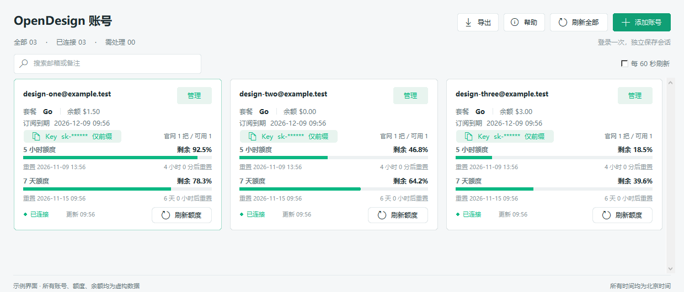

# OpenDesign 多账号额度管家

Windows 桌面工具：独立登录多个 OpenDesign 账号，加密保存登录会话，再通过接口查询订阅、额度和余额。

**非 OpenDesign 官方项目，与 OpenDesign、Google 无隶属关系。仅用于管理本人或已获授权的账号。**



## 功能

- 每个账号独立 Chrome / Edge 登录环境，由本人完成正常 Google 登录。
- 登录会话使用当前 Windows 用户的 DPAPI 加密保存在本机。
- 查询 5 小时及 7 天额度剩余百分比、两档重置时间与倒计时。
- 显示套餐、订阅本期结束时间、按量钱包余额（USD）和最后成功查询时间。
- 单账号刷新、刷新全部、搜索、CSV 导出及可选每 60 秒刷新。
- 查询失败保留上次成功数据，并明确显示失败状态。
- 同步官网 Key 的数量、状态与前缀；支持导入完整 Key、明确确认后新建或重建 Key。
- 本机持有完整 Key 时可点击遮罩复制；仅持有前缀时不会伪装成可恢复的完整 Key。

## Windows 运行

[下载 Windows 发布包](https://github.com/kennponn/OpenDesignRealtime/releases/latest/download/OpenDesignAccountManager-Windows.zip) · [查看全部版本](https://github.com/kennponn/OpenDesignRealtime/releases)

解压 Windows 发布包到固定目录（例如 `D:\OpenDesignRealtime`），双击 `OpenDesignCards.exe`。
首次运行没有任何账号，程序自动在可执行文件旁创建 `data` 文件夹。请不要从只读目录启动。

1. 点击「添加账号」，填写预计登录邮箱。
2. 在该账号的专用普通 Chrome / Edge 窗口中本人完成 Google 登录，进入 OpenDesign 控制台。
3. 回到工具，点击对应卡片「管理 → 保存会话」。
4. 确认允许正常关闭该账号的独立浏览器窗口后，工具临时使用仅限本机的浏览器连接读取 OpenDesign 会话，并核验邮箱与工作区。
5. 保存成功后直接刷新额度，不需要重复开网页。会话失效时需要重新登录。

添加另一个账号请新建卡片，不要在前一个账号的浏览器目录里换号。工具不处理 Google 密码、不绕过验证码或 Google 登录限制，也不读取 Google 登录 Cookie。

自动刷新仅在程序运行且已勾选时生效，不是常驻服务或服务端推送。最多两个并发查询。
日期统一显示为北京时间（UTC+8）。倒计时只在本机更新；到达重置时间后需要查询接口，不假设额度已经恢复。

## API Key

额度查询使用已保存的 OpenDesign 会话，**不需要 API Key，也不调用模型**。

- 官网已有 Key 列表只返回元数据和前缀，不能恢复完整旧 Key。卡片显示「仅前缀」不是未创建 Key。
- 「导入 Key」只加密保存本人提供的完整值，不联网验证归属或有效性。
- 「新建 Key」需要明确确认账号；创建响应中的完整值会立即加密保存。
- 「重建 Key」先新建、保存并核验，再撤销本人选择的旧 Key，不会删光所有 Key。
- 创建请求超时或撤销结果不确定时不自动重试；先到官网核对，再使用「核对上次操作」解除本地保护。
- 撤销旧 Key 会让使用它的外部软件失效。工具不会自动替换外部软件配置。
- 复制后 30 秒或正常关闭时，仅在剪贴板内容仍是刚复制的 Key 时清理。不能清除系统剪贴板历史、其他软件缓存或云同步。

创建与撤销逻辑经过模拟接口测试；测试不会操作真实账号。接口及订阅规则以官网实际返回为准。

## 源码运行

已在 Windows、Python 3.13 环境测试。需要安装 Google Chrome 或 Microsoft Edge。

```powershell
python -m venv .venv
.\.venv\Scripts\Activate.ps1
python -m pip install -r requirements.txt
python app.py
```

如需指定数据目录：

```powershell
python app.py --data-dir 'D:\OpenDesignRealtime\data'
python query.py --data-dir 'D:\OpenDesignRealtime\data' --email 'person@example.com'
```

CLI 查询结果包含账号邮箱及订阅数据，但不包含登录 Cookie 或完整 Key。仍请把自己的查询输出当作私人信息。
同一数据目录不要同时运行源码版和 EXE 版。

## 测试和打包

```powershell
python -m pip install -r requirements-dev.txt
.\test.ps1
.\build.ps1
```

生成 `dist\OpenDesignCards.exe`。构建配置仅包含程序与图标，**不包含 `data`、浏览器目录或个人账户**。
测试使用虚构账号和临时数据，不需要真实账号。Tk 界面测试需要 Windows 图形桌面。

## 迁移和备份

正常关闭工具及所有对应独立浏览器窗口后，把程序所在目录及 `data` 一起复制到新位置，再从新位置运行。
DPAPI 凭证只适用于原 Windows 用户；不保证换电脑、重装系统或切换 Windows 用户后能解密。
在其他 Windows 用户下运行需要重新登录。不要为了备份把 `data` 放到公共仓库。

## 安全与发布

详见 [SECURITY.md](SECURITY.md) 和 [PUBLISHING.md](PUBLISHING.md)。
源码及发布包不含个人登录数据、真实账号截图、完整 Key 或私人诊断报告。
`data` 虽含加密凭证，但邮箱、订阅缓存及浏览器状态也属于私人信息，不能公开。
`.gitignore` 不是泄漏检测器；每次发布都需要检查 Git 和压缩包内容。

本项目尚未指定开源许可证；公开仓库不等于授予再分发或修改许可。发布者可以在确认后另行添加许可证。
